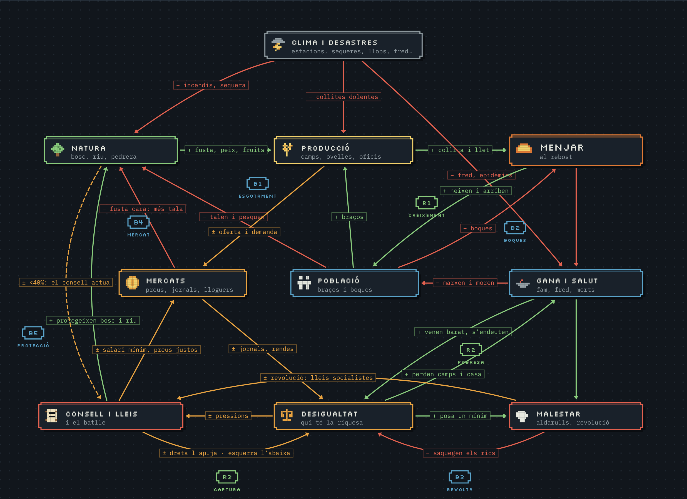
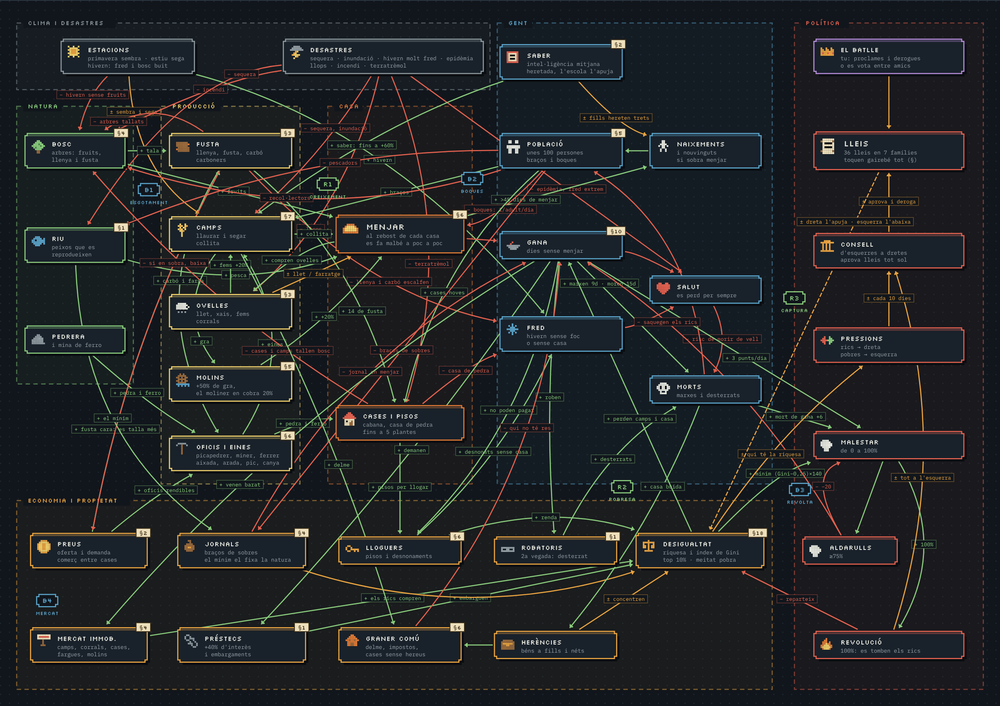
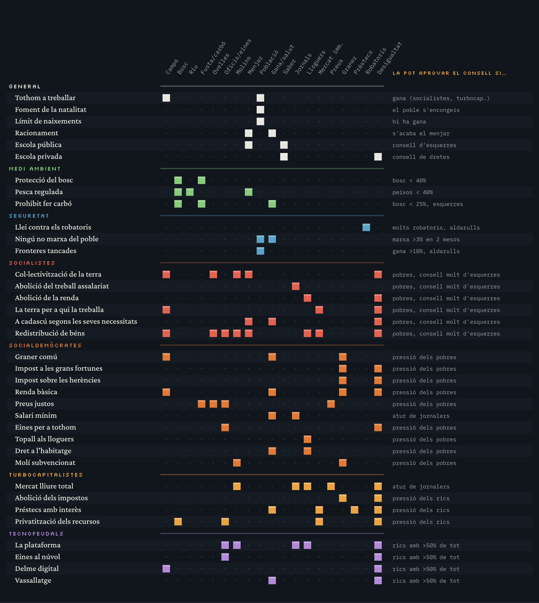

# El batlle

Joc de navegador en català on fas de batlle d'un poble. Tot el joc és un sol fitxer, `index.html`, sense dependències ni passos de compilació.

Segueix el joc a Instagram: [@el_batlle](https://www.instagram.com/el_batlle/).

## Crèdits

Basat en la idea de [@an_ai_tries_youtube](https://www.youtube.com/@an_ai_tries_youtube).

## Jugar

- En línia: https://miquel25.github.io/El-Batlle/ (un cop activat GitHub Pages)
- En local: obre `index.html` amb qualsevol navegador.

## Jugar amb amics

A la pantalla d'inici, **Juga amb amics** crea una sala amb un codi de 5 lletres (o un enllaç) per passar als amics. Si has entrat al compte, el teu nom a la sala és el teu nom de jugador, però el pots canviar només per a aquella sala. Cada jugador porta una família del mateix poble i les lleis s'aproven per votació entre tots; la política dinàmica funciona igual.

Els missatges entre jugadors passen per un petit repetidor a Cloudflare ([`worker/sales`](worker/sales/README.md)), que funciona des de qualsevol xarxa i es desplega sol amb GitHub Actions. Si el repetidor no respon, els navegadors es connecten directament amb WebRTC ([PeerJS](https://peerjs.com/)). L'amfitrió ha de tenir el joc obert mentre dura la partida. Per provar-ho amb un altre repetidor: `?relay=URL` (o `?relay=no` per anar directe); amb un altre servidor PeerJS: `?peer=host:port`.

## Partides desades

**Partides desades** (a l'inici) o **Desa o carrega** (durant la partida) obre la finestra dels comptes. Amb un nom de jugador i una contrasenya pots desar fins a 5 pobles i continuar-los des de qualsevol navegador. El correu és opcional i només serveix per recuperar la contrasenya. Les partides es guarden a Cloudflare, amb el pla gratuït ([`worker/comptes`](worker/comptes/README.md)). Per provar-ho amb un altre servidor: `?comptes=URL`.

## Trofeus

Amb el compte iniciat, **Trofeus** obre la vitrina: a dalt els de diamant, després or, plata i, a baix, bronze. Els que encara no tens surten en silueta; toca'n un per veure què demana i, si ja el tens, quin dia el vas aconseguir. Es guarden al compte i compten en qualsevol mode, també jugant amb amics. Des de **El meu usuari**, el compte de l'administrador (Miquel) pot veure quants jugadors han guanyat cada trofeu i qui són.

## Com es lliga tot

Al poble cap sistema va sol: el menjar fa néixer gent, la gent tala el bosc, la gana fa vendre camps barats, la desigualtat empeny el consell i el consell canvia les lleis que reparteixen el menjar. Per això el joc és tan poc lineal. Aquests esquemes mostren qui toca qui: en verd el que fa pujar (+), en vermell el que fa baixar (−) i en groc el que depèn de les lleis o de l'estació (±). Les etiquetes **R** marquen els bucles que s'alimenten sols i les **B** els que es frenen sols.

### Esquema simplificat

- **R1 Creixement:** més menjar fa néixer i arribar gent, i més braços fan més collita.
- **B1 Esgotament:** més gent talant i pescant deixa menys arbres i peixos.
- **B2 Boques:** més gent menja més, i el rebost baixa.
- **R2 Pobresa:** qui passa gana ven barat o s'endeuta, perd camps i casa i encara passa més gana.
- **B3 Revolta:** la gana i la desigualtat porten malestar, aldarulls i revolucions que reparteixen la riquesa.
- **R3 Captura del consell:** qui té la riquesa empeny el consell cap al seu costat, i les lleis que aprova li donen encara més. Funciona cap a la dreta i cap a l'esquerra, i per això el poble tendeix a quedar-se en un dels dos extrems.
- **B4 Mercat:** quan una cosa escasseja el preu puja i se'n fa més. La fusta cara, però, fa talar més bosc.
- **B5 Protecció:** quan el bosc o el riu baixen del 40%, el consell els protegeix.

### Esquema complet

### Què toca cada llei

## Publicar amb GitHub Pages

1. Ves a **Settings → Pages** del repositori.
2. A **Build and deployment**, tria **Deploy from a branch**.
3. Branca `main`, carpeta `/ (root)`, i desa.

En un parell de minuts el joc serà accessible a l'adreça de dalt.

## Llicència

MIT. Vegeu el fitxer [LICENSE](LICENSE).
