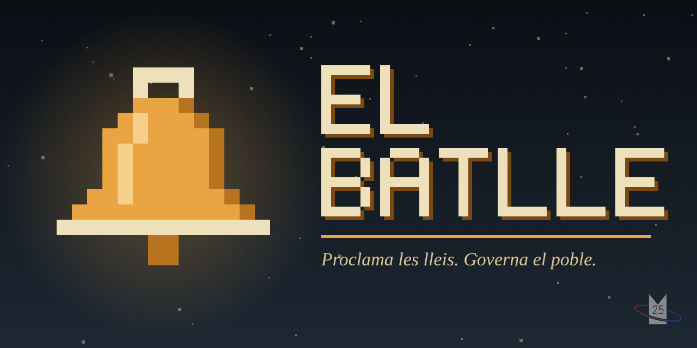

# El batlle

Joc de navegador en català on fas de batlle d'un poble. Tot el joc és un sol fitxer, `index.html`, sense dependències ni passos de compilació.

## Crèdits

Basat en la idea de [@an_ai_tries_youtube](https://www.youtube.com/@an_ai_tries_youtube).

## Jugar

- En línia: https://miquel25.github.io/El-Batlle/ (un cop activat GitHub Pages)
- En local: obre `index.html` amb qualsevol navegador.

## Jugar amb amics

A la pantalla d'inici, **Juga amb amics** crea una sala amb un codi de 5 lletres (o un enllaç) per passar als amics. Cada jugador porta una família del mateix poble i les lleis s'aproven per votació entre tots; la política dinàmica funciona igual.

Els missatges entre jugadors passen per un petit repetidor a Cloudflare ([`worker/sales`](worker/sales/README.md)), que funciona des de qualsevol xarxa i es desplega sol amb GitHub Actions. Si el repetidor no respon, els navegadors es connecten directament amb WebRTC ([PeerJS](https://peerjs.com/)). L'amfitrió ha de tenir el joc obert mentre dura la partida. Per provar-ho amb un altre repetidor: `?relay=URL` (o `?relay=no` per anar directe); amb un altre servidor PeerJS: `?peer=host:port`.

## Publicar amb GitHub Pages

1. Ves a **Settings → Pages** del repositori.
2. A **Build and deployment**, tria **Deploy from a branch**.
3. Branca `main`, carpeta `/ (root)`, i desa.

En un parell de minuts el joc serà accessible a l'adreça de dalt.

## Llicència

MIT. Vegeu el fitxer [LICENSE](LICENSE).
